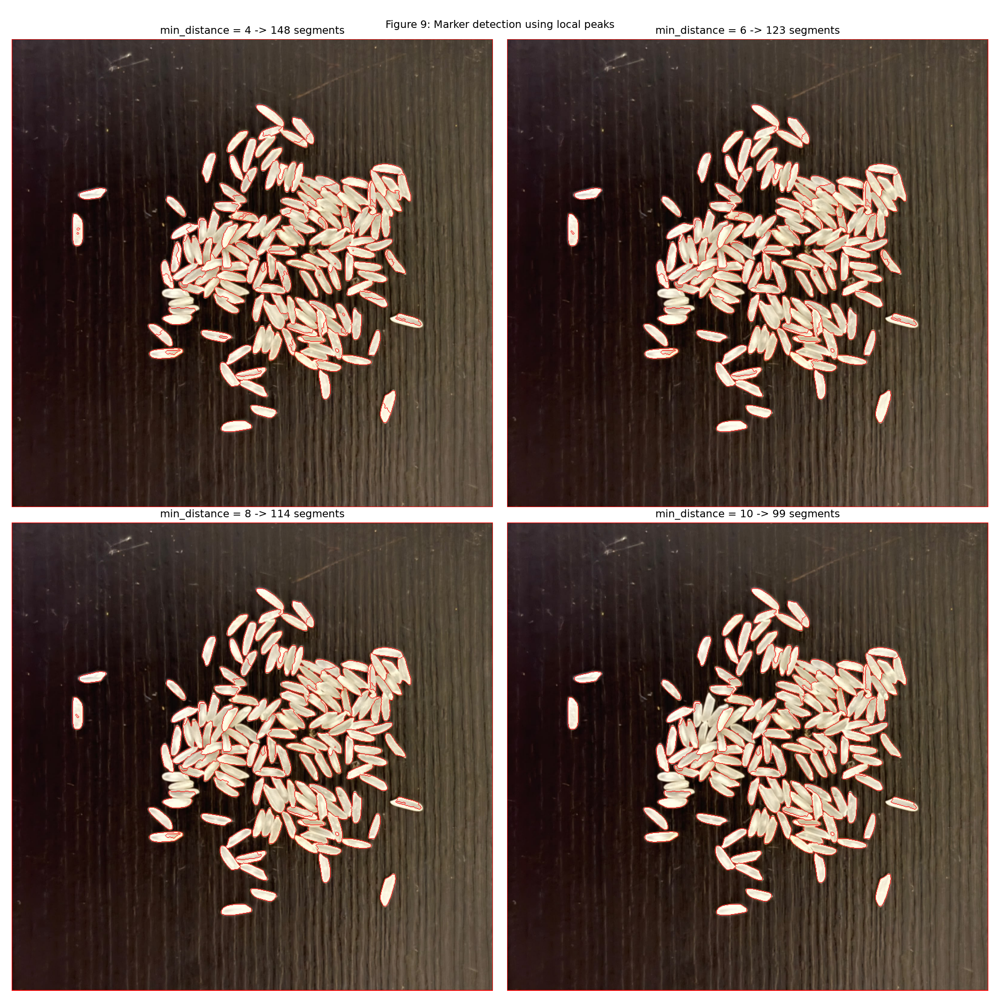
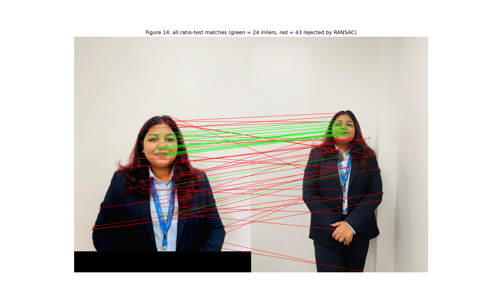
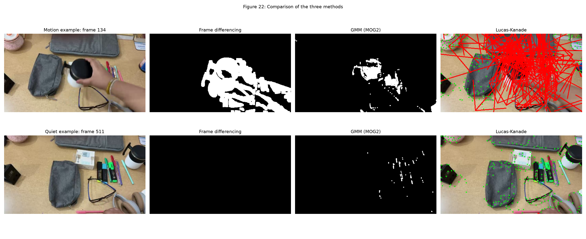

# CCA 3: Computer Vision Assignment (Units 3, 4 and 5)

Name: Ruchika Lohani


PRN: 1272250612

## About
Practical assignment on image restoration, segmentation, feature extraction, object recognition and motion estimation, done on my own photographs and my own video. Everything is in one notebook: `CCA3_CV_Assignment.ipynb`.

| Task | Content |
|---|---|
| Task 1 | Gaussian and salt-and-pepper noise, median and Gaussian filtering (PSNR, SSIM), Otsu thresholding, erosion, dilation, opening, closing, Canny, watershed |
| Task 2 | HOG, SIFT keypoints, descriptor matching (ratio test and RANSAC), matching after rotation and resizing |
| Task 3 | Haar cascade (Viola-Jones) and YOLOv8n, with comparison |
| Task 4 | Frame differencing, GMM (MOG2) background subtraction, Lucas-Kanade optical flow |

## Folder structure

```
cv-cca3-assignment/
  CCA3_CV_Assignment.ipynb
  requirements.txt
  README.md
  data/        input photographs (https://drive.google.com/file/d/1tLp7j6HS2tJs92wfMBUANKnra3hjpDEF/view?usp=sharing)
  outputs/     all result figures and CSV tables
```

## Setup
Tested with Python 3.13 on Windows.
```bash
python -m venv venv
venv\Scripts\activate
pip install -r requirements.txt
```
Ultralytics may install `opencv-python` as well. If OpenCV gives errors, run:
```bash
pip uninstall -y opencv-python opencv-contrib-python
pip install opencv-contrib-python
```

## Input data
Put these files in the `data/` folder:

| File | Description |
|---|---|
| `original.jpg` | original portrait photograph |
| `second1.jpg`, `second2.jpg` | second photographs of the same scene (SIFT matching) |
| `objects.jpg` | rice grains on a dark table (watershed) |
| `objects_scene.jpg` | bottle, remote, phone, mouse and notebook (detection) |
| `video.mp4` | original video of my study table, about 29 seconds, 60 fps |

The photographs are in this repository. The raw video is too large for Git: download it from Google Drive: (https://drive.google.com/file/d/1tLp7j6HS2tJs92wfMBUANKnra3hjpDEF/view?usp=sharing) and save it as `data/video.mp4`.

The photographs and the video were transferred to the computer via WhatsApp, so they are compressed copies of the originals.

The Haar cascade file `data/haarcascade_frontalface_default.xml` is downloaded from the OpenCV GitHub repository by the notebook, and `yolov8n.pt` is downloaded automatically by Ultralytics.

## How to run
```bash
jupyter notebook
```
Open `CCA3_CV_Assignment.ipynb` and choose Kernel > Restart & Run All. The SIFT, YOLO and video cells take a while. All figures are saved in `outputs/`.

## Example results




## Links
Project explanation video: (paste Google Drive link here)